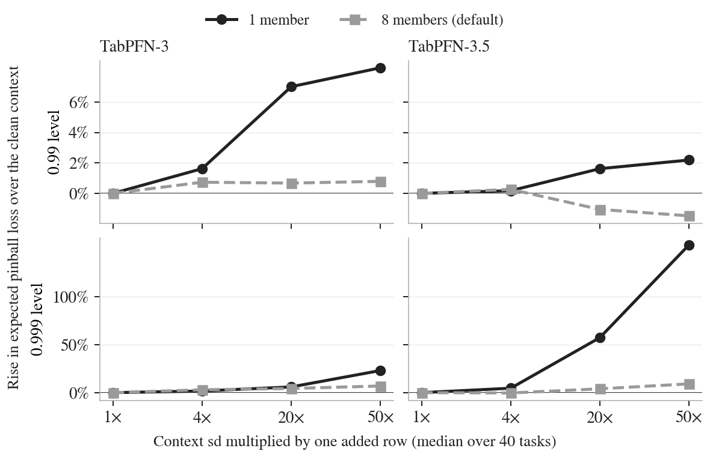

# Upper-tail predictions in tabular foundation models

Experiments for my master's thesis on how tabular foundation models predict
large target values, how one extreme value in the context changes their predictions
and whether capping that value improves accuracy.

## Main results

**Scale and tail shape.** On a generator whose tail index rises with a feature that
leaves the scale unchanged, TabPFN-3 with one ensemble member reproduces 88% of the true
change in the conditional scale and 42% of the change in the tail shape. With four members
it reproduces 95% and 19%: the ensemble lowers the shape. TabICLv2 reproduces 98% and 43%
with four members (44% of the shape with one). An extreme-value oracle on the same 2000
rows recovers 99% of the shape. Gradient boosting
has the same gap (87% and 45%), so it is not specific to foundation models.

**One extreme context target.** On 40 synthetic tasks, one added extreme target made the
context standard deviation 50 times larger. Measured by the expected loss under the
generator's distribution, TabPFN-3 with one ensemble member lost **23% more at the 99.9th
percentile** and **8% more at the 99th** than on the clean context. An earlier README gave
+83% at the 99.9th percentile. That figure came from the drawn test targets, where a task
holds about one exceedance at that level. The rerun of 22 October 2026 reproduces it on
the drawn targets (+83%), so most of it came from the few exceedances, not from the model.

**How much one row costs depends on the configuration.** The same dose at the package
default of eight members costs TabPFN-3 under 1% at the 99th percentile and 7% at the
99.9th. TabPFN-3.5 with one member loses 2% at the 99th but 154% at the 99.9th; at its
default of eight members it loses nothing at the 99th and 9% at the 99.9th. Where the row
costs, capping takes most of the loss back (-7.7% at the 99th percentile for TabPFN-3 with
one member); where it costs nothing, capping costs a little (+1.1% for TabPFN-3.5 at
eight).



On ten samples of the freMTPL2sev insurance claims, each with one dominant claim,
capping lowered the 99th-percentile loss in most samples for every model. TabDPT
improved in **7 of 10**; the other models improved in **9 or 10**. These are selected
samples from one dataset; the results do not establish that capping helps on every new
task.

The figure includes LimiX-2 and Causilo, released in September 2026 and first and third
on the TabArena leaderboard of 28 September. Like the models measured before, both
standardise the target by its mean and standard deviation; one added row moves their
upper quantiles ([notebook](analysis/models_2026_09.ipynb)).


**The benefit of capping depends on the model.** A confirmation of the frozen cap on new
draws, on 1 October 2026, split by model. Under a unit error in one context row that
shifts the sd by 2 or more, the cap lowered the 99th-percentile loss of TabPFN-3 on 4 of
5 insurance tables and that of TabICLv2 on 1 of 5. On a synthetic task with a segment of legitimate large values, 3 of
the 4 capped context rows came from the segment, which paid for the cap on a clean
context: +0.45% at the 99th percentile for TabPFN-3, +10% for TabICLv2.

**With its default ensemble TabPFN-3 needs the cap less.** The results above fit TabPFN-3
with one ensemble member. Its default is eight, half of which fit a power transform of the
target. Rerun on the same draws on 21 October 2026, eight members cut the cost of the added
row on the synthetic task from +10% to +2.3% at the 99th percentile and the cap's gain from
-9.6% to -2.6%. On the insurance tables they do not help: the visible unit error cost eight
members more than one on 4 of 5 tables, while the cap lowered the loss on 5 of 5.

**A log of the target beats the cap at the 99th percentile, at a price further out.** The
vendor's insurance example fits claim amounts on log(1 + y), so a log of the context target
was measured beside the cap on the same draws. Under the unit error it lowered the
99th-percentile loss below the cap's on 5 of 5 insurance tables for TabPFN-3 and 4 of 5 for
TabICLv2. For TabICLv2 it was below raw on 5 of 5, where the cap had managed 1. It is not
free. It changes every clean prediction and by mean loss costs on a clean context in 3 of
the 10 table-and-model pairs. Its worst clean context raises the 99th-percentile loss by
115% (TabPFN-3 on freMTPL2sev), against 2.9% at worst for the cap, which touches nothing
on most clean contexts. At the 99.9th percentile it puts TabPFN-3's quantile for the
legitimate segment at 1.9 times the truth and raises its clean loss on two insurance
tables by 11 to 15%. For TabICLv2 it lifts a too-low extreme quantile and lowers that loss
on every table.

**TabPFN-3.5, the package default since September, barely needs the cap.** Run on the same
draws on 21 October 2026, on a GPU. With one ensemble member its clean extreme quantile is
far closer to the truth than TabPFN-3's. The added row costs it +2.1% at the 99th
percentile but +49% at the 99.9th, which the cap takes back. At its default of eight
members the row costs nothing over the synthetic test set at either level, so there the
cap only costs: +5.4% at the 99th percentile on a clean context with a legitimate segment.
On the insurance tables the unit error still costs it +0.2% to +3.7% at the 99th
percentile; the cap lowers that on 5 of 5 tables, by less than 2%. Log stays below the cap
on 4 of 5 tables and again places the segment's 99.9th percentile at 1.9 times the truth.
The sensitivity is therefore a property of a configuration, not of the model family.

**The effect does not hinge on where the row sits or on a small context.** Checks of 27
and 28 October 2026, run after the results they check. Wherever the added row sits in the
features, it changes TabPFN-3's 99th percentile by the same amount within 6 points;
TabICLv2's change is weaker at the edge in one cell of twelve. At 10 000 context rows the
row moves both foundation models' quantile at least as much as at 2000, though TabPFN-3's
direction varies between seeds. At one member the cap's gain grows there from -7.7% to
-12.8%. At TabPFN-3's default ensemble the row barely costs at 10 000 rows, so the cap
gains only 1.4% and in 7 of 10 seeds. On Brazilian_houses, one of two more tables with
natural leverage, the largest row raises TabPFN-3's quantile instead of lowering it. The
cap wins there in most cells but at one member loses on their sum, from one cell per model
where the largest row was genuine.

**TabICLv2 keeps the effect at its default ensemble; TabPFN-3 loses it through a transform
of the target.** At eight members a dose of 20 lowers TabICLv2's 99th percentile by 16% at
2000 rows and by 37% at 10 000, as at one member. On freMTPL2sev it falls by 18%. Its
members see different views of the features but one standardised target. Four of
TabPFN-3's eight default members fit a power transform of the target. With it switched
off eight members behave like one: the transform accounts for 78% to 93% of the gap
between one member and eight on the synthetic task. It shields the 99th percentile, not
the 99.9th. For TabICLv2 the row moves the quantile more than the loss: about +2% at the
99th percentile, while at the 99.9th the row lowers the loss.

**A cap conditioned on the model's own scale spares a legitimate segment.** Every repair
above reads the target alone, so a legitimate extreme looks to it like an error. The
conditional cap of 29 October 2026 applies the rule of `clip_200` to residuals
standardised by the model's own cross-fitted median and 90th percentile. On the synthetic
task with a high-risk segment it lowers no segment row in 19 of 20 seeds for TabPFN-3 and
in 17 of 20 for TabICLv2, where `clip_200` lowers at least one in every seed. The
segment's extra loss at the 99.9th percentile falls from 5.3% and 15.9% to 0.05% and
0.6%. The added error row is still lowered in every seed and TabPFN-3 keeps its -9.6% at
the 99th. That segment is the easiest case, one binary feature that carries the whole
scale. On the five insurance tables the conditional cap does what `clip_200` does. Log
stays lower at the 99th percentile on both designs; a fit takes 1.6 to 2.2 times as long.

## Scope of the thesis

Three questions, asked of two foundation models, TabPFN-3 (`TabPFN-V3` in the result
files) and TabICLv2, with gradient boosting (`GBM`) as the tree control:

1. Do the predicted upper quantiles follow a change in the conditional scale and in the
   tail shape?
2. How much does one extreme target in the context move them and how often does such a
   row occur in public tables?
3. When does capping the context target lower the loss and what does it cost legitimate
   large values?

The 99th percentile is the main level; the 99.9th is secondary. The cap is `clip_200`:
the context median plus 200 robust standard deviations (IQR / 1.349). Its main rival, a
log of the context target, is measured beside it from 21 October 2026. TabPFN-3 and
TabICLv2 run with one ensemble member unless a result says eight, the package default of
both. TabPFN v2.5, v2.6
and 3.5, EXAONE-Tabular, TabDPT, LimiX-2 and Causilo, with CatBoost and XGBoost as further
tree controls, are supplementary checks.

Pre-training of small models under controlled priors and fine-tuning of TabICLv2 were
explored and are outside the thesis. Whether the tail failures come from the pre-training
prior or from the architecture is left to later work.

## What the results do not show

- A changed prediction is not necessarily a worse one. A lower loss after capping does
  not show that the capped value was an error.
- The implied tail index, inverted from a ratio of two predicted quantiles, is the
  GPD-equivalent shape at those levels. It does not identify the asymptotic tail of a
  model or a dataset.
- The four tail families of the generator (GPD, Fréchet, Burr, absolute Student t) are
  all regularly varying. Transfer to lognormal or other heavy tails is untested.
- The oracle uses structure a general learner does not have. Its 99% does not rule out
  sample size as a cause of the shape gap.
- An sd shift of 4 or more appeared in subsamples of 2 of 99 public datasets. This
  describes the sampled contexts, not a rate of data errors.
- TabPFN rescales its output grid by the context sd
  (`borders * y_train_std_ + y_train_mean_`), so one extreme row leaves few borders over
  the data. How much of the loss this causes has not been isolated.
- `clip_200` and the log arm were both chosen after development results and confirmed on
  draws already used. The cap helps TabPFN-3 and costs TabICLv2. Log helps both at the
  99th percentile in most tested cells but overshoots a legitimate segment at the 99.9th.
  Neither is a recommendation for the model family. The conditional cap was designed
  after both outcomes on those draws were known; its predictions were written first.
- Eight ensemble members were measured in the confirmation, in the dose curve of
  22 October 2026 and in the checks of 27 and 28 October. The other results of part two
  and the conditional cap use one member. TabPFN-3.5 ran on a GPU, every other TabPFN
  result on CPU.
- The target transform explains TabPFN-3's ensemble gap on the synthetic task at 2000
  rows. Real tables and TabICLv2 under such a transform are untested.
- The pinball loss on drawn test targets at the 99.9th percentile rests on about one
  exceedance per task. The synthetic results from 21 October 2026 on report the expected
  loss as well; earlier synthetic numbers at that level are noisy. The expected loss is
  taken under the generator's law, which caps the uniform draw at 1 - 1e-9; the ideal
  GPD would add mass no test set can show, 12.6% of the mean at a tail index of 0.9.
- `crps` and `twcrps` in `common/metrics.py` are twice the plain mean pinball loss over
  the chosen levels, which on an uneven grid is not a quadrature of the CRPS integral. On
  a GPD with known CRPS they miss it by up to 2.5% on the 102 levels where they were used,
  and a difference between two forecasts by up to a factor of two. No thesis result uses
  them; `crps_weighted` weights each level by its cell and is within 0.1%.

## Code

| Part | Main scripts in `experiments/` | Notebook |
|---|---|---|
| Scale and tail shape | `h1_shape_vs_scale/`: `shape_of_x`, `scale_of_x`, `oracle_xi_of_x`, `sample_complexity`; checks `tail_families`, `vincentization`, `xi_residual`, `reference_instrument`, `instrument_ceiling`, `dissociation_real_slope` (with `K_SHARES`) | [h1_shape_vs_scale](analysis/h1_shape_vs_scale.ipynb) |
| Extreme context target | `h2_leverage/`: `influence` (with `POSITION`), `influence_real`, `grid_occupancy`, `prevalence_data`, `prevalence_models`; coverage in `h1_shape_vs_scale/empirical_coverage`; output heads in `side/head_tail_family`, `side/head_tail_tabicl` | [h2_leverage](analysis/h2_leverage.ipynb), which calls `analysis/dose_ensemble.py`; the ensemble checks in `analysis/tabicl8.py` and `tabpfn_y.py` |
| Capping | `h3_repair/`: `clip_context`, `clip_context_real`, `unit_error_real`; confirmation `unit_error_confirm`, `legit_segment`, `recalibration`; the conditional cap `cclip` in `common/transforms.py` | [h3_repair](analysis/h3_repair.ipynb), which calls `analysis/confirm_ensemble_log.py`, `confirm_tabpfn35.py`, `h3_table.py` and `sample_selection.py`; `analysis/loss10k.py` and `conditional_cap.py`; predictions and outcomes in [PREREGISTRATION.md](PREREGISTRATION.md) |

Explored and left outside the thesis: pre-training and fine-tuning
(`h3_repair/prior_pretraining_*`, `h3_repair/tabicl_prior_finetune`), other repairs
(`evt_graft`, `graft_gate`, `tail_splice`, `robust_scale`, `repair*`, `mean_correction`),
the conditional mean (`mean_attainability`, `truncated_support`, `architecture_*`,
`mean_exaone`) and `side/coherence`, `side/credibility`.

- `analysis/thesis_numbers.py` recomputes every number the thesis quotes into one ledger.
- `common/`: data loading, the generator, model adapters and metrics. Models are built
  only in `common/models.py`.
- `run/`: the batch commands behind the result files.
- `results/`: one folder per part, as in `experiments/`. A suffix after the experiment
  name marks a separate run: a model (`_exaone`), one ensemble member (`_nest1`) or a
  context size (`_n200`). `results/provenance.csv` records the commit, package versions
  and settings of every run. The commits are from the development history, which is not
  published in full.
- `data/`: dataset selections and sources.
- `requirements/`: one frozen environment per group of models, whose torch versions
  conflict: `venv-tfm` (TabPFN 8.4, TabICL 2.1), `venv-tfm9` (TabPFN 9.0, Causilo),
  `venv-tfm9cu` (TabPFN 9.0 with CUDA torch, for TabPFN-3.5 on the GPU), `venv-limix`,
  `venv-tabdpt`, `venv-tabfm`.

## Reproduce the figures

From the repository root:

```bash
python -m pip install -e ".[analysis]"
python -m analysis.supplement_figures
python -m analysis.thesis_figures
```

This uses stored results and needs no model weights, data download or GPU.
Plotted values are written to `supplement/` and `thesis/figures/`, which are not
tracked; README images go to `figures/`.

[Measurement rules](RULES.md) · [Predictions and outcomes](PREREGISTRATION.md)
