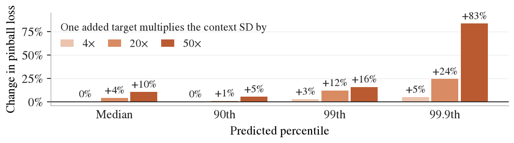
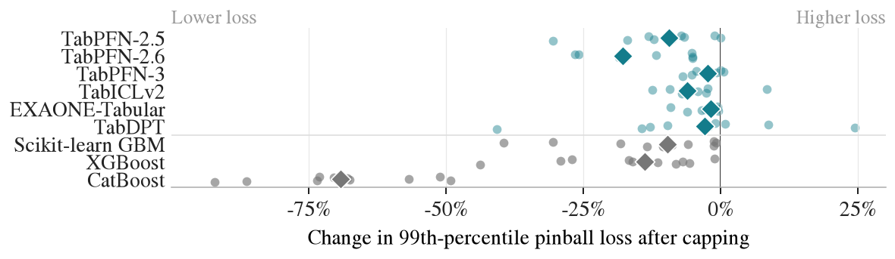

# Upper-tail predictions in tabular foundation models

Experiments for my master's thesis on how tabular foundation models predict
large target values, how one extreme value in the context changes their predictions
and whether capping that value improves accuracy.

## Main results

**Scale and tail shape.** On a generator whose tail index rises with a feature that
leaves the scale unchanged, TabICLv2 reproduces 98% of the true change in the
conditional scale and 44% of the change in the tail shape. TabPFN-3 reproduces 95% and
42% with one ensemble member; its default ensemble lowers the shape to 19%. An
extreme-value oracle on the same 2000 rows recovers 99% of the shape. Gradient boosting
has the same gap (87% and 45%), so it is not specific to foundation models.

**One extreme context target.** On 40 synthetic tasks, one added extreme target made the
context standard deviation 50 times larger. TabPFN-3's median increase in pinball loss
was **83% at the 99.9th percentile**, compared with **10% at the median**. Capping brought
median losses back close to the clean-context baseline at all four percentiles.



On ten samples of the freMTPL2sev insurance claims, each with one dominant claim,
capping lowered the 99th-percentile loss in most samples for every model. TabDPT
improved in **7 of 10**; the other models improved in **9 or 10**. These are selected
samples from one dataset; the results do not establish that capping helps on every new
task.

The figure includes LimiX-2 and Causilo, released in September 2026 and first and third
on the TabArena leaderboard of 28 September. Like the models measured before, both
standardise the target by its mean and standard deviation; one added row moves their
upper quantiles ([notebook](analysis/models_2026_09.ipynb)).



**The benefit of capping depends on the model.** A confirmation of the frozen cap on new
draws, on 1 October 2026, split by model. Under a unit error in one context row that
shifts the sd by 2 or more, the cap lowered the 99th-percentile loss of TabPFN-3 on 4 of
5 insurance tables and that of TabICLv2 on 1 of 5. On a synthetic task with a segment of legitimate large values, 3 of
the 4 capped context rows came from the segment, which paid for the cap on a clean
context: +0.45% at the 99th percentile for TabPFN-3, +10% for TabICLv2.

## Scope of the thesis

Three questions, asked of two foundation models, TabPFN-3 (`TabPFN-V3` in the result
files) and TabICLv2, with gradient boosting (`GBM`) as the tree control:

1. Do the predicted upper quantiles follow a change in the conditional scale and in the
   tail shape?
2. How much does one extreme target in the context move them and how often does such a
   row occur in public tables?
3. When does capping the context target lower the loss and what does it cost legitimate
   large values?

The 99th percentile is the main level; the 99.9th is secondary. The cap is `clip_200`:
the context median plus 200 robust standard deviations (IQR / 1.349). TabPFN v2.5 and
v2.6, EXAONE-Tabular, TabDPT, LimiX-2 and Causilo, with CatBoost and XGBoost as further
tree controls, are supplementary checks.

Pre-training of small models under controlled priors and fine-tuning of TabICLv2 were
explored and are outside the thesis. Whether the tail failures come from the pre-training
prior or from the architecture is left to later work.

## What the results do not show

- A changed prediction is not necessarily a worse one. A lower loss after capping does
  not show that the capped value was an error.
- The implied tail index, inverted from a ratio of two predicted quantiles, is the
  GPD-equivalent shape at those levels. It does not identify the asymptotic tail of a
  model or a dataset.
- The four tail families of the generator (GPD, Fréchet, Burr, absolute Student t) are
  all regularly varying. Transfer to lognormal or other heavy tails is untested.
- The oracle uses structure a general learner does not have. Its 99% does not rule out
  sample size as a cause of the shape gap.
- An sd shift of 4 or more appeared in subsamples of 2 of 99 public datasets. This
  describes the sampled contexts, not a rate of data errors.
- TabPFN rescales its output grid by the context sd
  (`borders * y_train_std_ + y_train_mean_`), so one extreme row leaves few borders over
  the data. How much of the loss this causes has not been isolated.
- `clip_200` was chosen after development results. It helps TabPFN-3 and costs TabICLv2;
  it is not a recommendation for the model family.
- `crps` and `twcrps` in `common/metrics.py` are twice the plain mean pinball loss over
  the chosen levels. On an uneven grid of levels this is a discrete quantile score, not a
  quadrature of the CRPS integral.

## Code

| Part | Main scripts in `experiments/` | Notebook |
|---|---|---|
| Scale and tail shape | `h1_shape_vs_scale/`: `shape_of_x`, `scale_of_x`, `oracle_xi_of_x`, `sample_complexity`; checks `tail_families`, `vincentization`, `xi_residual`, `reference_instrument`, `instrument_ceiling`, `dissociation_real_slope` | [h1_shape_vs_scale](analysis/h1_shape_vs_scale.ipynb) |
| Extreme context target | `h2_leverage/`: `influence`, `influence_real`, `grid_occupancy`, `prevalence_data`, `prevalence_models`; coverage in `h1_shape_vs_scale/empirical_coverage`; output heads in `side/head_tail_family`, `side/head_tail_tabicl` | [h2_leverage](analysis/h2_leverage.ipynb) |
| Capping | `h3_repair/`: `clip_context`, `clip_context_real`, `unit_error_real`; confirmation `unit_error_confirm`, `legit_segment`, `recalibration` | [h3_repair](analysis/h3_repair.ipynb); the confirmation in [PREREGISTRATION.md](PREREGISTRATION.md) |

Explored and left outside the thesis: pre-training and fine-tuning
(`h3_repair/prior_pretraining_*`, `h3_repair/tabicl_prior_finetune`), other repairs
(`evt_graft`, `graft_gate`, `tail_splice`, `robust_scale`, `repair*`, `mean_correction`),
the conditional mean (`mean_attainability`, `truncated_support`, `architecture_*`,
`mean_exaone`) and `side/coherence`, `side/credibility`.

- `common/`: data loading, the generator, model adapters and metrics. Models are built
  only in `common/models.py`.
- `run/`: the batch commands behind the result files.
- `results/`: one folder per part, as in `experiments/`. A suffix after the experiment
  name marks a separate run: a model (`_exaone`), one ensemble member (`_nest1`) or a
  context size (`_n200`). `results/provenance.csv` records the commit, package versions
  and settings of every run. The commits are from the development history, which is not
  published in full.
- `data/`: dataset selections and sources.
- `requirements/`: one frozen environment per group of models, whose torch versions
  conflict: `venv-tfm` (TabPFN 8.4, TabICL 2.1), `venv-tfm9` (TabPFN 9.0, Causilo),
  `venv-limix`, `venv-tabdpt`, `venv-tabfm`.

## Reproduce the figures

From the repository root:

```bash
python -m pip install -e ".[analysis]"
python -m analysis.supplement_figures
```

This uses stored results and needs no model weights, data download or GPU.
Plotted values are written to `supplement/`, which is not tracked; README images go
to `figures/`.

[Measurement rules](RULES.md) · [Predictions and outcomes](PREREGISTRATION.md)
